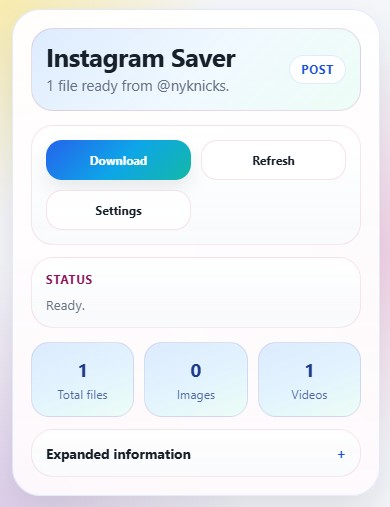
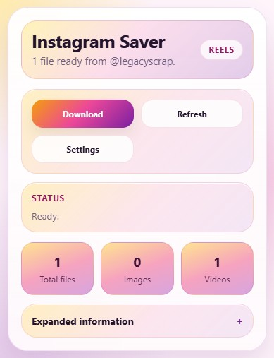
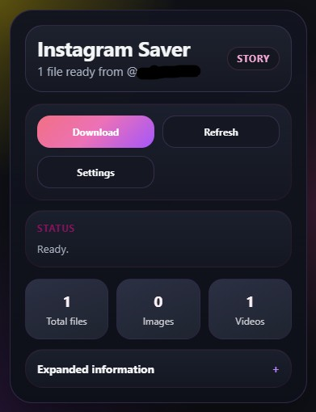
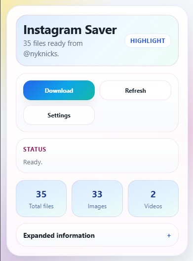
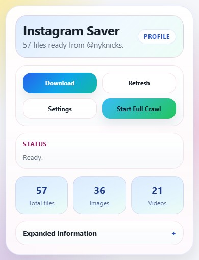

# Instagram Saver

Instagram Saver is a Chrome extension for downloading media from Instagram pages you can already view in your browser session. It supports posts, reels, stories, highlights, profile-page batches, and saved-post batches from the saved-posts page or a saved collection. For stories and profiles, it reads available account and post identifiers from the loaded page before resolving files through Instagram's APIs; saved pages use the authenticated saved-feed APIs.

## What It Does

- Downloads media from the current Instagram post or reel, all currently available stories for an account, or a highlight
- Supports profile-page batch downloads and full-profile crawls that keep running automatically until the profile ends or Instagram rate limits the session
- Supports batch downloads and resumable full crawls for all saved posts or an individual saved collection
- Uses your logged-in Instagram session, so private or restricted content still follows normal Instagram access rules
- Can export optional JSON metadata and batch reports alongside downloads
- Lets you customize folders, filenames, duplicate handling, full-crawl pacing, and download prompts

## Installation

1. Open `chrome://extensions/` in Chrome or another Chromium-based browser.
2. Enable Developer mode.
3. Click Load unpacked.
4. Select this repository folder.

## Usage

1. Open an Instagram page for a post, reel, story, highlight, profile, or saved posts/collection.
2. Click the extension icon to open the popup.
3. Start the download from the popup, or use the Instagram page context menu for a direct download.

On profile and saved-post pages, the popup can also start or resume a larger crawl. The extension keeps moving through saved 48-post checkpoints automatically, spaces out full-crawl requests according to the selected crawl pace, and only relies on the stored cursor when a crawl is interrupted, cancelled, or rate limited. Saved-page crawl checkpoints are kept separate for all saved posts and each collection.

## Screenshots

The popup adjusts its actions and status based on the Instagram page you have open.

| Post | Reel | Story |
| --- | --- | --- |
|  |  |  |

| Highlight | Profile Crawl |
| --- | --- |
|  |  |

## Settings

The options page includes:

- Light, dark, or themed UI modes
- Easy-click download mode
- Confirmation before download
- Metadata sidecar export
- Batch report export
- Duplicate handling controls
- Profile/saved media filters, per-batch post limits, and full-crawl pace
- Folder, media filename, and metadata filename templates
- Download history export and reset

Available template tokens are `{username}`, `{id}`, `{kind}`, `{type}`, `{index}`, and `{date}`.

## Metadata

When metadata export is enabled, the extension writes a JSON sidecar file with available details such as username, identifiers, caption text, timestamps, media URLs, dimensions, and output filenames. If batch report export is enabled, it also writes a report covering skipped files, failures, and profile pagination diagnostics.

Within a single batch, planned filenames are made collision-safe automatically. If the same path already exists from an earlier run, Chrome still decides the final on-disk rename behavior.

## Permissions

- `contextMenus` to add a page-level download action
- `downloads` to queue downloads
- `scripting` to inject the content script when needed
- `storage` to persist settings and crawl checkpoints
- `tabs` to read the active tab for popup state and availability badges
- Host access is limited to `instagram.com` and its subdomains.
- The toolbar action is disabled on non-Instagram pages.

## Limitations

- The extension does not bypass Instagram login, privacy, or follow restrictions.
- It does not assemble DASH or HLS streams or do ffmpeg-style muxing.
- Profile and saved-post downloads and full crawls are best-effort and depend on Instagram's current APIs, cursors, and rate limits. Saved posts and collections must be accessible to the logged-in account.
- It does not crawl hashtags in the background.

## Development

1. Update the source files.
2. Reload the unpacked extension in `chrome://extensions`.
3. Test against real Instagram pages while logged in.
