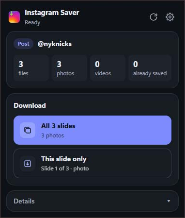
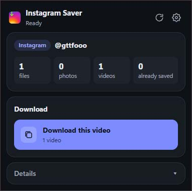
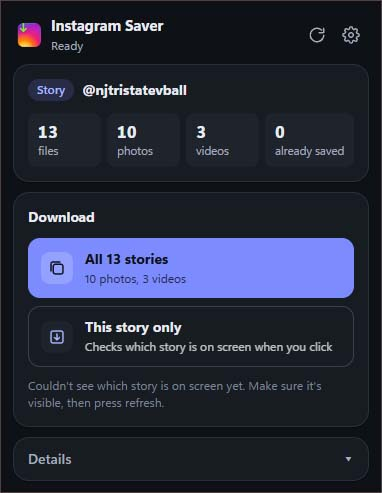
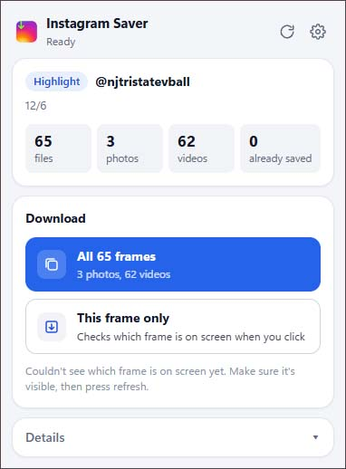
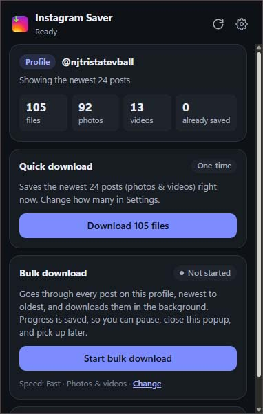
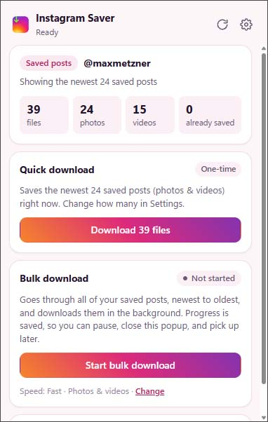

# Instagram Saver

A Chrome extension for downloading Instagram posts, reels, stories, highlights, profiles, and saved posts. It uses your existing Instagram session and respects the access you have on Instagram.

## Screenshots

| Posts | Reels | Stories |
| --- | --- | --- |
|  |  |  |

| Highlights | Profiles | Saved posts |
| --- | --- | --- |
|  |  |  |

## Install

1. Open `chrome://extensions` in Chrome or another Chromium-based browser.
2. Turn on **Developer mode**.
3. Select **Load unpacked** and choose this repository folder.

## Use

1. Open an Instagram post, reel, story, highlight, profile, or saved posts page.
2. Select the Instagram Saver extension icon.
3. Choose what to download.

For posts, stories, and highlights, choose the item currently on screen or the full set. For profiles and saved posts, use **Quick download** for the newest posts or **Bulk download** to work through the list in the background. Bulk progress is saved so you can resume later.

You can also right-click an Instagram page to download everything on the page or only the item on screen.

## Settings

Settings let you choose the download folder and file names, set quick-download limits and bulk speed, skip duplicates, and optionally save JSON info files or download reports. Settings are available from the extension's options page.

## Limitations

- You must be logged in and able to view the content on Instagram.
- Downloads depend on Instagram's current behavior and rate limits.
- The extension does not download hashtag pages or combine streamed video.

## Development

- Requires Node.js 20 or newer.
- Run tests with `npm test`.
- After changing the extension, reload it from `chrome://extensions`.
